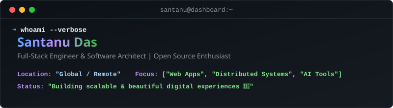

<!-- PHASE 1: ANIMATED TERMINAL BANNER -->
<picture>
  <source media="(prefers-color-scheme: dark)" srcset="https://raw.githubusercontent.com/santanudjucse-hash/santanudjucse-hash/main/dark.svg" />
  <source media="(prefers-color-scheme: light)" srcset="https://raw.githubusercontent.com/santanudjucse-hash/santanudjucse-hash/main/light.svg" />
  
</picture>

  

<!-- PHASE 2: GITHUB ACHIEVEMENTS & BADGES (badgeMaster Integration) -->
### 🏅 GitHub Achievements & Highlights

  <!-- GitHub Achievements Badges -->
  
  
  
  
  

  <!-- GitHub Special Badges -->
  
  
  

 

<!-- PHASE 3: SUMMARY CARDS (Theme-Aware Light & Dark Mode) -->
### 📊 Profile Metrics & Analytics

<picture>
  <source media="(prefers-color-scheme: dark)" srcset="https://github-profile-summary-cards.vercel.app/api/cards/stats?username=santanudjucse-hash&amp;theme=2077" />
  <source media="(prefers-color-scheme: light)" srcset="https://github-profile-summary-cards.vercel.app/api/cards/stats?username=santanudjucse-hash&amp;theme=default" />
  
</picture>
<picture>
  <source media="(prefers-color-scheme: dark)" srcset="https://github-profile-summary-cards.vercel.app/api/cards/most-commit-language?username=santanudjucse-hash&amp;theme=2077" />
  <source media="(prefers-color-scheme: light)" srcset="https://github-profile-summary-cards.vercel.app/api/cards/most-commit-language?username=santanudjucse-hash&amp;theme=default" />
  
</picture>

  

<picture>
  <source media="(prefers-color-scheme: dark)" srcset="https://github-readme-streak-stats.herokuapp.com/?user=santanudjucse-hash&theme=dark&hide_border=true" />
  <source media="(prefers-color-scheme: light)" srcset="https://github-readme-streak-stats.herokuapp.com/?user=santanudjucse-hash&theme=default&hide_border=true" />
  
</picture>

  

<!-- PHASE 4: TECH STACK MATRIX -->
### 🛠️ Languages & Technologies

  
  
  
  
  
  
  
  
  

 

<!-- PHASE 5: CONTRIBUTION SNAKE & WORKFLOW STATUS -->

  

<!-- PHASE 4.5: FEATURED AI & MACHINE LEARNING PROJECTS -->
### 🚀 Featured AI & Machine Learning Systems

<table align="center" width="100%">
  <tr>
    <td width="50%" valign="top">
      <h4 align="center">🎬 <a href="https://github.com/santanudjucse-hash/AI-Video-Assistant">AI Video Assistant</a></h4>
      

        
        
        
        
      

      <ul>
        <li>Multimodal meeting intelligence platform converting YouTube & video files into actionable insights.</li>
        <li>Dual-engine transcription: local <b>OpenAI Whisper</b> & <b>Sarvam AI</b> (Hinglish/Indic speech-to-text translation).</li>
        <li>Map-Reduce meeting summarization, automated action item extraction, and grounded <b>RAG Q&A chat</b> with ChromaDB.</li>
      </ul>
    </td>
    <td width="50%" valign="top">
      <h4 align="center">🔬 <a href="https://github.com/santanudjucse-hash/Multi-Agent-Research-System">Multi-Agent Research System</a></h4>
      

        
        
        
        
      

      <ul>
        <li>Autonomous 4-agent collaborative pipeline: Search Agent, Reader Agent, Writer Chain, and Critic Chain.</li>
        <li>Performs live grounded web research via Tavily API and BeautifulSoup DOM decomposition.</li>
        <li>Automated self-evaluation scoring and downloadable Markdown research reports.</li>
      </ul>
    </td>
  </tr>
</table>

### 🐍 Contribution Activity Matrix

  

<picture>
  <source media="(prefers-color-scheme: dark)" srcset="https://raw.githubusercontent.com/santanudjucse-hash/santanudjucse-hash/output/github-snake-dark.svg" />
  <source media="(prefers-color-scheme: light)" srcset="https://raw.githubusercontent.com/santanudjucse-hash/santanudjucse-hash/output/github-snake.svg" />
  
</picture>

  

<!-- PHASE 6: CONNECT & SOCIALS -->
### 📬 Connect with Me

  
  

